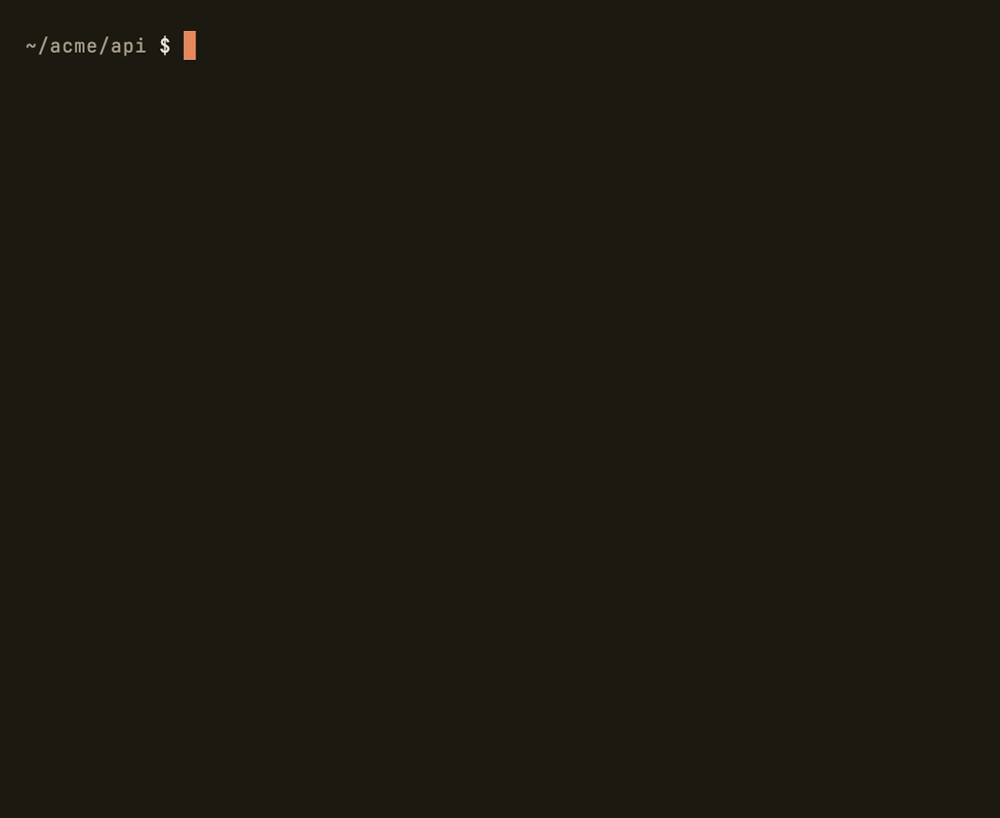

# 📔 Gournal

**A Developer's Command-Line Journal with Git Integration**

[](https://github.com/aelshinawy/gournal/actions/workflows/ci.yml)
[](https://www.npmjs.com/package/gournal)
[](https://www.npmjs.com/package/gournal)
[](https://opensource.org/licenses/MIT)

Gournal is a command-line work journal. You log what you did, and gournal builds your standups and work logs from the entries. It stores everything in a local SQLite database. It needs no account. It links your entries to the pull requests, commits, and reviews that `gh` reports. An MCP server lets AI agents such as Claude Code log work for you.



## Install

You need Node.js 22.13 or newer and Git 2.7 or newer. With Git older than 2.7, or without Git, gournal puts entries in the `uncategorized` project and records no repository or branch.

```bash
npm install -g gournal
```

## Supported platforms

Gournal supports macOS, Linux, and Windows (x64). CI runs on `windows-latest` (Windows Server 2025). Keep your journal on a local disk. See [Supported platforms](https://gournal.aelshinawy.com/docs/start-here/install/#supported-platforms) for the requirements and the limits on each system.

## Quickstart

```bash
gournal add "Fixed the flaky auth test" --tags bug,testing
gournal add "Review the retry change" --kind next
gournal standup
gournal standup --week
gournal setup claude
```

## Documentation

Read the guides and the full reference at [gournal.aelshinawy.com/docs](https://gournal.aelshinawy.com/docs/).

## License

MIT
